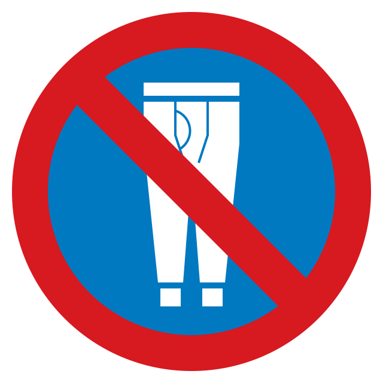

# No Qiuku 不穿秋裤

你是否也像我一样，怀疑一切被预设的结论？怀疑上课是不是必须得记笔记，冬天是不是非要穿秋裤？怀疑让你记笔记、穿秋裤的老师家长，是不是有某种不可告人的动机？

怀疑你的老师私下跟文具厂勾结，以卖出成千上万的笔记本；怀疑你妈是秋裤集团幕后董事长，她编造新型秋裤骗局让所有人恐慌并从中获利。

不穿秋裤，拿回自己主宰冷暖的权利。就像我们所有`被剥夺的权利`一样。

 

Do you, like me, question everything we are told to take for granted? Whether you really need to take notes in class, or whether you have to wear long johns in winter? Do you suspect that the teachers and parents insisting on these things might have ulterior motives?

That your teachers are secretly colluding with stationery manufacturers to sell notebooks by the thousand; that your mother is the shadowy chairwoman of Big Long Johns, manufacturing a new long johns scare and profiting from it?

Refuse to wear long johns. Reclaim your right to decide how warm you need to be — just as we would any other _right denied to us_.

